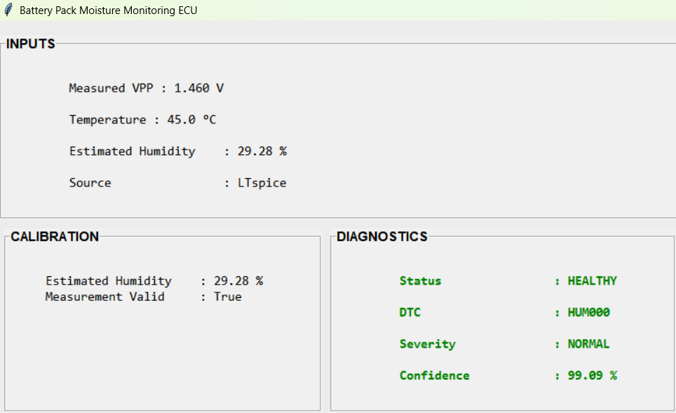
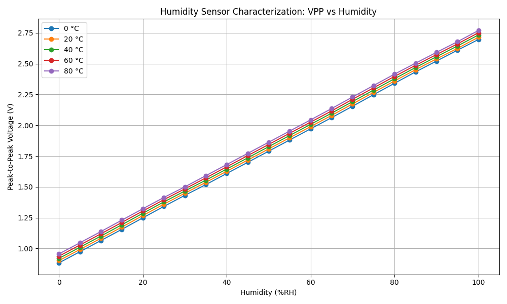
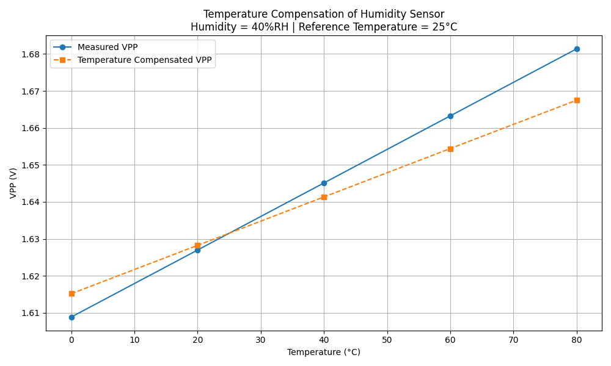
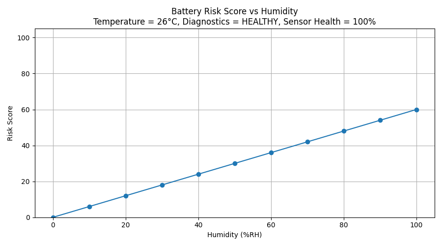
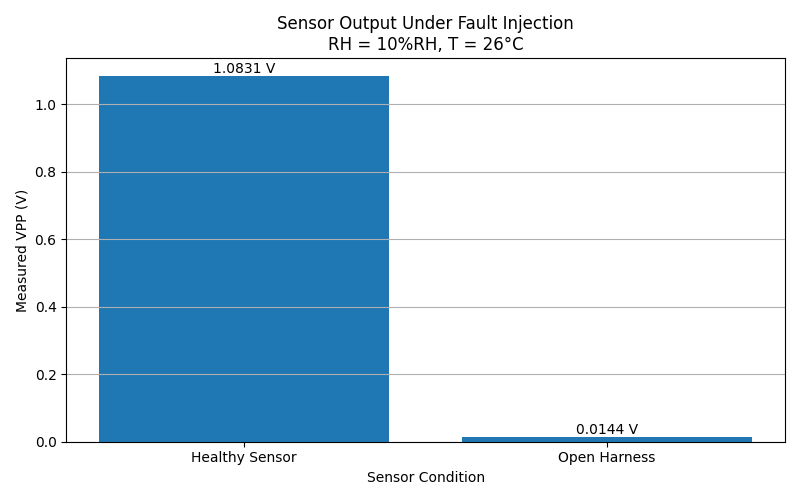

# EV Battery Pack Moisture Monitoring & Thermal Management (BTMS)

A simulated automotive ECU that monitors moisture in an EV battery pack, diagnoses sensor faults, scores battery risk and controls heating/cooling hardware. The analog hardware is modelled in **LTspice**, and the ECU logic, diagnostics and dashboard are written in **Python**.

Mini project for *Automotive Embedded Systems* at **TU Chemnitz** (Chair of Measurement and Sensor Technology, Prof. Dr.-Ing. Olfa Kanoun), Group 29. The full report is in [`docs/Project_Report.pdf`](docs/Project_Report.pdf).



## What it does

- **Sensing (LTspice):** a capacitive humidity sensor model feeds an analog front end (charge amplifier, gain, filtering) that produces a measured peak-to-peak voltage (VPP).
- **Calibration:** VPP is converted to relative humidity with a linear fit, `RH = (VPP_corr - 0.8677) / 0.0061`. The sensitivity comes from LTspice characterisation sweeps, not a datasheet.
- **Temperature compensation:** database-driven correction of VPP across temperature.
- **Fault diagnostics:** detects open harness, short to ground and short to battery, and reports diagnostic confidence and sensor health.
- **Predictive maintenance:** rolling sensor-health history, average health and trend, with a maintenance recommendation.
- **Battery risk assessment:** `Risk = 0.40 H + 0.20 T + 0.15 SHI + 0.15 DC + 0.10 TM`, mapped to four protection stages (Monitoring, Charging Limitation, Protection Active, Immediate Inspection/Shutdown), with a recommended action and root-cause summary. The weights are engineering assumptions, not fitted values.
- **Thermal management (BTMS):** heating below 15 °C, standby 15–35 °C, cooling above 35 °C. The decision drives a comparator and MOSFET heating/cooling driver in LTspice.
- **Dashboard:** a Tkinter GUI showing humidity, faults, risk, protection stage and thermal mode.

## Architecture

```
 Python ECU  --(params: RH, T, fault mode)-->  LTspice AFE (HumiditySensor_AFE_v5.asc)
     ^                                                   |
     |  <-------------- measured VPP --------------------+
     |
     +-- calibration -> diagnostics -> predictive maintenance -> risk assessment -> thermal logic
     |                                                                                |
     |                                       BTMS driver (BTMS_Controller.asc) <------+
     +-- history.csv logging  +  Tkinter dashboard
```

## Repository layout

```
src/        Python ECU modules, LTspice bridge, dashboard and plot scripts
LTSpice/    HumiditySensor_AFE_v5.asc (analog front end), BTMS_Controller.asc (heating/cooling driver)
Database/   LTspice characterisation sweeps: healthy and three fault cases
Results/    Plots, circuit captures, dashboard screenshots, sample history.csv
docs/       Full project report (PDF)
```

## Running it

Requirements: Python 3.9+, and **LTspice** (Windows) for live simulation. The Database mode and the plot scripts work without LTspice.

```bash
pip install -r requirements.txt
cd src
python battery_pack_monitor.py        # main ECU menu
```

- Scripts use relative paths, so run them from inside `src/`.
- For live LTspice runs, set the executable path if it is not at the default location:
  - Windows (PowerShell): `$env:LTSPICE_EXE = "C:\Path\To\LTspice.exe"`
- Regenerate the analysis plots (no LTspice needed): `python vpp_vs_humidty_graph.py`, `python temperature_compensation_graph.py`, `python risk_vs_humidity_graph.py`, `python healthy_vs_fault.py`, `python sensor_health_vs_fault.py`.

## Selected results

| Calibration: VPP vs humidity | Temperature compensation |
|---|---|
|  |  |

| Risk score vs humidity | Healthy vs fault VPP |
|---|---|
|  |  |

Fault scenarios: [open harness](Results/fault_open_harness.png), [short to ground](Results/fault_short_to_ground.png), [short to battery](Results/fault_short_battery.png). Circuits: [AFE](Results/AFE_Circuit.png), [cooling/heating driver](Results/COOLING_HEATING.png).

## Limitations

This is a simulation-based study. There is no real sensor hardware, the thermal thresholds and risk weights are engineering choices, and battery health and safety index are interpretive indicators, not measured capacity. See Chapter 15 of the report.

## Team (Group 29)

| Member | Contribution (from the report) |
|---|---|
| Chaitanyarani Kiragi | Python ECU modules (partial), BTMS actuation hardware (comparator/MOSFET) and fault scenarios in LTspice, sensor output (VPP) validation, dashboard GUI (partial) |
| Prasad Pai | System architecture and LTspice AFE circuits, simulation setup, dashboard GUI (partial), module integration, CSV logging and testing, Python ECU modules (partial) |
| Supriya Madenahalli Rajashekaraiah | Literature review and requirements, result graphs and validation tables, LTspice assistance, presentation, test-case validation |
| Tayiba Fathima Syed | Test-case execution, report formatting and diagrams, logs and screenshots, LTspice assistance, proofreading, demo run-through |

## License

MIT, see [LICENSE](LICENSE).
